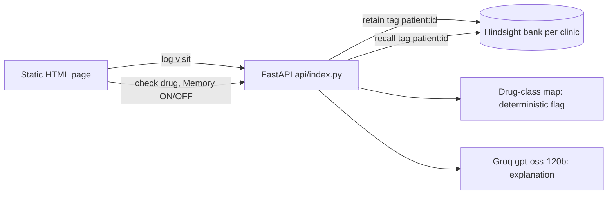

# AdverseWatch

> ⚠️ **DEMO ONLY – NOT MEDICAL ADVICE.** All patients are **FICTIONAL synthetic data**. Not clinically validated. No accuracy claims are made.

A drug-reaction **memory agent** for small Indian clinics without hospital EHR systems. The doctor logs each visit's prescription and any adverse reaction; AdverseWatch **retains** it per patient in [Hindsight](https://github.com/vectorize-io/hindsight) memory. When a new drug is about to be prescribed it **recalls** that patient's history, flags same-class / known cross-reactivity risk (citing the past visit date and drug) and shows what worked before.

Built for Hack With Bangalore 4.0 by **Team Phoenix** – Madhan Raj & Ahmed Faraz M (SJCIT).

## How Hindsight is used
- One memory bank per clinic (`HINDSIGHT_BANK_ID`, default `adversewatch-clinic-demo`).
- Every visit → `retain()` with tag `patient:<id>` (patient-scoped memory), timestamped to the visit date.
- Every prescription check → `recall()` filtered to that patient's tag (`tags_match="all_strict"`).
- Timeline → `list_memories()` for the patient tag.
- The UI shows each retain/recall call and the recalled memories.

A small deterministic drug→class map (penicillins, cephalosporins, NSAIDs, sulfonamides, macrolides, fluoroquinolones, ACE inhibitors, statins; penicillin↔cephalosporin noted as a known caution) grounds the flag. The Groq LLM (`openai/gpt-oss-120b`) only explains the flag from recalled memories.



## Demo (learning loop)
1. Pick **Asha K. (FICTIONAL)**, click Reset. Check `amoxicillin` → no flag (OFF and ON).
2. Log visit: `amoxicillin`, reaction `itchy rash on trunk`.
3. Check `ampicillin` → Memory OFF: no flag; Memory ON: **HIGH** citing the amoxicillin visit. `cephalexin` → **CAUTION** (penicillin↔cephalosporin).
4. Pick **Meena D.**, check `sulfamethoxazole` → flagged, and azithromycin shown as worked before.

## Run locally
```bash
python -m venv .venv && . .venv/bin/activate
pip install -r requirements.txt uvicorn pytest httpx
cp .env.example .env   # add keys (optional)
uvicorn api.index:app --reload   # http://localhost:8000
pytest -q
```

## Modes
- `HINDSIGHT_API_KEY` set → real Hindsight. Otherwise a clearly labelled **offline in-memory fallback** (the UI shows which).
- `GROQ_API_KEY` set → Groq. Otherwise a labelled **mock template explainer**.

Never commit `.env`. Deployable to Vercel (`vercel.json` + `api/index.py`).
